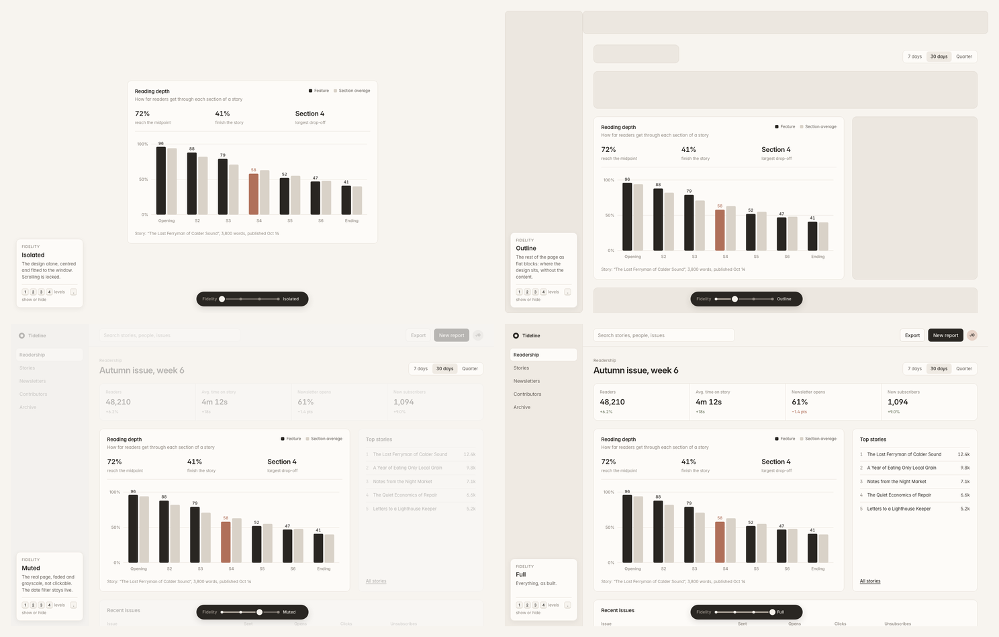

# Design Lab

A collection of design experiments, useful tools, and interactions I've built to solve real problems, explore ideas, or make things a little more delightful.

I'm a product designer who likes to build. Sometimes that means making a tool to improve my workflow. Other times, it's exploring an interaction because I think there's a more interesting way something could work.

This is where I share those experiments, along with the code and thinking behind them.

## Projects

### [Fidelity Slider](fidelity-slider/)

**Dial the visual context of an interface up or down.**

A floating slider that lets you move between four levels—Isolated, Outline, Muted, and Full—without rebuilding your prototype. Focus entirely on the design, keep a hint of its surroundings, or bring the whole interface back.

[Watch the demo](fidelity-slider/docs/fidelity-slider-demo.mp4) · [Explore the component](fidelity-slider/) · [View the source](fidelity-slider/src/fidelity-slider.js)

---

More experiments to come.

[Portfolio](https://maria-sara.com) · [LinkedIn](https://www.linkedin.com/in/finellimaria)
