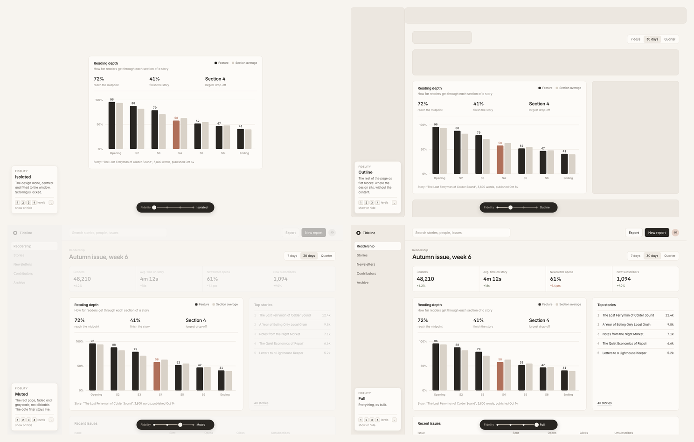

# Fidelity Slider

One lever from "only the design" to "the full interface around it".

People judge a design differently depending on how much of the surrounding interface they can see. Fidelity Slider lets you change that live, mid-review or mid-test, without building separate versions. Point it at the design you're evaluating. Everything else on the page counts as context, and a small floating slider turns that context up or down.

It's a single dependency-free script (about 14 KB minified, under 6 KB gzipped) that works on any HTML page, prototype or single-page app.



Watch it in motion: [docs/fidelity-slider-demo.mp4](docs/fidelity-slider-demo.mp4) (35 seconds, no audio).

## The four levels

| Level        | What people see                                                          | Useful for                                                                                         |
| ------------ | ------------------------------------------------------------------------ | -------------------------------------------------------------------------------------------------- |
| **Isolated** | The design alone, centred and fitted to the window. Scrolling is locked. | First impressions, comprehension tests, comparing variants on their own merits                     |
| **Outline**  | The rest of the page as flat blocks, with no content                     | A sense of place (where the design sits, how big it is next to the page) without competing content |
| **Muted**    | The real page, faded and grayscale, not clickable                        | Judging hierarchy and fit in context while attention stays on the design                           |
| **Full**     | Everything, as built                                                     | Task-based testing, discoverability, final validation                                              |

At **Isolated**, clipping and scrolling ancestors are opened up so nothing crops the design, and a design larger than the window scales down to fit with 32px around it (it never scales up). If the design changes size (a drawer opens, a tab switches), it re-fits. Leaving Isolated restores every scroll position.

## Quick start

```html
<div class="card" data-fs-focus>…the design you're evaluating…</div>

<script src="fidelity-slider.js" data-ui="on"></script>
```

That's all you need. Press `.` to show or hide the slider, or `1` to `4` to jump between levels.

## Run the demo

The demo is a fictional reading-analytics tool built with synthetic data.

```sh
cd fidelity-slider
python3 -m http.server 8000
# open http://localhost:8000/demo/
```

Opening `demo/index.html` directly from disk also works in Chromium-based browsers and Safari. A local server is the most reliable option in every browser.

You can also see an integration in a different host interface at `http://localhost:8000/examples/integration.html`, which shows a dialog over a settings page using the host's own typeface.

## Controls

| Input                     | Action                                                                                    |
| ------------------------- | ----------------------------------------------------------------------------------------- |
| `.`                       | Show or hide the slider                                                                   |
| `1` `2` `3` `4`           | Isolated, Outline, Muted, Full                                                            |
| `[` `]`                   | Step down or up one level                                                                 |
| Drag the thumb            | The page changes as the thumb passes each stop, then the thumb settles on the nearest one |
| Click or tap the track    | Jump to the nearest stop                                                                  |
| Arrow keys, `Home`, `End` | Move the slider when it has focus                                                         |

Page-wide shortcuts are ignored while someone is typing in an input, textarea, select or contenteditable element, and when Cmd, Ctrl or Alt is held. They're registered in the capture phase, so a host handler that stops propagation can't swallow them.

## Configuration

Options can be set in four ways. When the same option appears in more than one place, the first match in this list wins:

1. **URL parameters**: `?fidelity=outline&fidelity-focus=.card&fidelity-ui=on`
2. **Script attributes**: `<script src="fidelity-slider.js" data-focus=".card" data-level="muted">`
3. **A global object set before the script loads**: `window.FidelitySlider = { focus: ".card" }`
4. **Markup attributes**: `data-fs-focus`, `data-fs-keep`, `data-fs-ignore`

| Option   | Script attribute | URL              | Default           | Description                                                                                                                                                    |
| -------- | ---------------- | ---------------- | ----------------- | -------------------------------------------------------------------------------------------------------------------------------------------------------------- |
| `focus`  | `data-focus`     | `fidelity-focus` | `[data-fs-focus]` | CSS selector for the outermost element of the design (the card or modal itself, not its inner content)                                                         |
| `keep`   | `data-keep`      |                  | `[data-fs-keep]`  | Context that stays real at Outline and Muted because the design depends on it (a filter that drives a chart, a page title). It still disappears at Isolated.   |
| `level`  | `data-level`     | `fidelity`       | `full`            | Starting level: `isolated`, `outline`, `muted`, `full`, or `0` to `3`                                                                                          |
| `ui`     | `data-ui`        | `fidelity-ui`    | `off`             | `on` shows the slider at load. It's hidden by default so the people you're testing with see only the interface.                                                |
| `keys`   | `data-keys`      |                  | `digits`          | `shift` moves the level keys to Shift + 1 to 4 (for interfaces that already use the digits). `off` disables the level keys, but `.` and the slider still work. |
| `url`    | `data-url`       |                  | `on`              | `off` stops the slider from writing `?fidelity=` to the address bar                                                                                            |
| `label`  | `data-label`     |                  | `Fidelity`        | Text before the track, also used as the accessible name                                                                                                        |
| `labels` |                  |                  |                   | Level names, for example `{ isolated: "Solo", full: "Everything" }` (global object only)                                                                       |

Elements marked `data-fs-ignore` are never treated as context. Use it for your own review toolbars, captions or notes.

By default the slider keeps `?fidelity=` in the address bar in sync, so copying the URL captures the current level and one build can produce a link for each level.

### Choosing the focus

- Target the outermost element of the design. If Outline shows one huge block swallowing the page, the focus is too deep in the tree. Point it at an outer element, or add a `keep`.
- Context is worked out structurally. Every sibling along the path from the focus up to `<html>` becomes one context region. To get a more detailed Outline, give the page clear sections.
- The slider re-marks the page when nodes are added or removed, so it follows single-page-app re-renders without extra setup.

## JavaScript API

```js
fidelitySlider.set("muted"); // or 0 to 3
fidelitySlider.get(); // "muted"
fidelitySlider.levels; // ["isolated", "outline", "muted", "full"]
fidelitySlider.toggle(); // show or hide the control; toggle(true) or toggle(false) to force it
fidelitySlider.refresh(); // re-mark and re-fit after an unusual DOM change
fidelitySlider.destroy(); // remove everything and restore the page

window.addEventListener("fidelityslider:change", (e) => {
  console.log(e.detail.level);
});
```

In a bundler, import the script for its side effects (`import "./fidelity-slider.js"`) and configure it with `window.FidelitySlider` before the import runs. The `data-` attributes only work from a `<script>` tag.

## Customizing the look

All styling lives in CSS custom properties. The defaults are built into the script at zero specificity, so any `:root { --fs-… }` rule in your CSS overrides them, whatever the load order. [`src/fidelity-slider.tokens.css`](src/fidelity-slider.tokens.css) lists every token with its default value, an optional terracotta accent and a dark-host preset (`<html class="fs-dark">`). Changing tokens never changes behavior.

| Token                                                                   | Controls                                                                                                                    |
| ----------------------------------------------------------------------- | --------------------------------------------------------------------------------------------------------------------------- |
| `--fs-font-family`                                                      | The slider's typeface. Defaults to Inter and falls back to the system sans. Set it to `inherit` to use the host's typeface. |
| `--fs-canvas`                                                           | Background behind the design at Isolated and Outline                                                                        |
| `--fs-block`, `--fs-block-line`, `--fs-block-radius`                    | Context blocks at Outline                                                                                                   |
| `--fs-muted-opacity`, `--fs-muted-filter`                               | How far context recedes at Muted                                                                                            |
| `--fs-ease`                                                             | The easing curve for every transition                                                                                       |
| `--fs-ui-bg`, `--fs-ui-shadow`, `--fs-ui-label`, `--fs-ui-text`         | The pill container and its text                                                                                             |
| `--fs-track`, `--fs-fill`, `--fs-stop`, `--fs-stop-on`                  | The track, the filled portion and the stop dots                                                                             |
| `--fs-thumb`, `--fs-thumb-ring`, `--fs-thumb-shadow`, `--fs-focus-ring` | The thumb and its keyboard focus ring                                                                                       |
| `--fs-ui-bottom`, `--fs-z`                                              | Placement and stacking                                                                                                      |

The script doesn't load fonts. If you want Inter, load it on the page. The demo self-hosts it from `demo/fonts/`.

## Accessibility

- The control is a WAI-ARIA `slider` with `aria-valuenow`, `aria-valuetext` (the level name), an accessible label and `aria-keyshortcuts`.
- A polite live region announces level changes, including changes made with the page-wide keys while the slider is hidden.
- While hidden, the control is `inert` and `aria-hidden`, so it can't be reached by Tab or a screen reader.
- A visible focus ring appears on keyboard focus.
- The touch target extends beyond the visible 24px track without changing how the control looks.
- `prefers-reduced-motion: reduce` turns off every transition, both in the control and on the page.
- Muted and Outline set `pointer-events: none` on context so people can't wander off the design. Keyboard users can still Tab into context elements. If that matters for your test, mark the context `inert` yourself.

## Browser support

Current Chromium, Firefox and Safari. It relies on the individual `translate` and `scale` CSS properties, `:is()`, `inert`, Pointer Events and `ResizeObserver` (2022 and later).

## Project layout

```
fidelity-slider/
  src/
    fidelity-slider.js           the component (the only file you need)
    fidelity-slider.tokens.css   optional token overrides
  demo/                          standalone demo with synthetic data
    index.html  demo.css  demo.js
    fonts/InterVariable.woff2  fonts/OFL.txt
  examples/integration.html      integration into a different interface
  docs/levels.png                screenshot used in this README
  docs/fidelity-slider-demo.mp4  demo video
  LICENSE
  THIRD_PARTY_NOTICES.md
```

## License

MIT for the component, demo and examples. See [LICENSE](LICENSE). Inter, which ships with the demo only, is under the SIL Open Font License 1.1. See [THIRD_PARTY_NOTICES.md](THIRD_PARTY_NOTICES.md).
